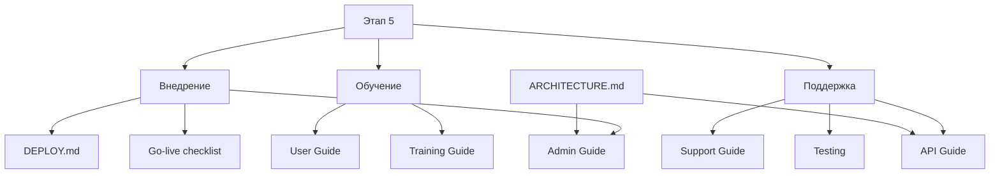

# Документация информационной системы ГОЧС

> **Назначение:** единая точка входа в эксплуатационную документацию проекта `gochs-system`.  
> **Область:** актуальная объединённая система на ASP.NET Core 8 + EF Core 8 + SQLite.  
> **Принцип сопровождения:** при изменении функциональности документация должна обновляться вместе с кодом.

## 1. Для кого эта документация

| Аудитория | С чего начать | Что содержит |
|---|---|---|
| Руководитель / заказчик | [Этап 5 — внедрение и поддержка](STAGE_5_IMPLEMENTATION_AND_SUPPORT.md) | границы решения, план внедрения, ввод в эксплуатацию, сопровождение |
| Оператор ГО и ЧС | [Руководство пользователя](USER_GUIDE.md) | ежедневная работа и сквозные бизнес-сценарии |
| Системный администратор | [Руководство администратора](ADMIN_GUIDE.md) | установка, конфигурация, backup/restore, обновление, безопасность |
| Разработчик / интегратор | [API и интеграции](API_GUIDE.md) | авторизация, CSRF, API, импорт, вложения |
| Тренер | [План обучения](TRAINING_GUIDE.md) | программа обучения и проверка навыков |
| Поддержка | [Регламент сопровождения](SUPPORT_GUIDE.md) | инциденты, диагностика, эскалация |
| Команда запуска | [Go-live checklist](GO_LIVE_CHECKLIST.md) | контроль перед запуском и после запуска |

## 2. Существующие документы проекта

Новый комплект дополняет, а не дублирует уже существующую документацию:

- [README проекта](../README.md) — быстрый запуск.
- [Архитектура](../ARCHITECTURE.md) — устройство системы и бизнес-правила.
- [Функциональные модули](../MODULES.md) — задания 6–19 и исходные проекты.
- [Серверное развёртывание](DEPLOY.md) — Caddy, HTTPS, секреты, backup/restore.
- [Тестирование](testing/README.md) — план, кейсы, приёмка, нагрузка и отчёт.

## 3. Карта документации

## 4. Источник истины

При расхождении материалов приоритет имеет:

1. фактический код и схема текущей версии;
2. миграции базы данных;
3. `ARCHITECTURE.md`;
4. эксплуатационная документация;
5. учебные отчёты и презентации.

Расхождение документации с кодом должно оформляться как дефект документации.

## 5. Границы текущей версии

Текущая версия:

- использует одну операторскую модель доступа и **не имеет RBAC**;
- не реализует юридически значимую УКЭП;
- использует внутренние уведомления, а не SMS/e-mail;
- работает с одной SQLite-базой и одним серверным процессом;
- сериализует изменяющие запросы внутри процесса;
- не предназначена для горизонтального масштабирования;
- принимает PDF/PNG/JPEG до 10 МБ, но не выполняет антивирусную проверку;
- формирует PDF через печать HTML в браузере;
- содержит автоматизированные тестовые скрипты, но фактический результат прогона должен фиксироваться отдельно в `docs/testing/TEST_REPORT.md`;
- содержит учебные формы документов, которые должны быть сверены с регламентами конкретной организации перед нормативным применением.

## 6. Когда обновлять документацию

Документация пересматривается при изменении:

- пользовательского сценария;
- URL или контракта API;
- модели данных;
- бизнес-правил;
- авторизации;
- серверной конфигурации;
- backup/restore;
- форматов документов;
- порядка внедрения и поддержки;
- известных ограничений.

Для релиза рекомендуется фиксировать версию/commit, дату развёртывания, миграции, smoke-test, backup/restore check и известные ограничения.
